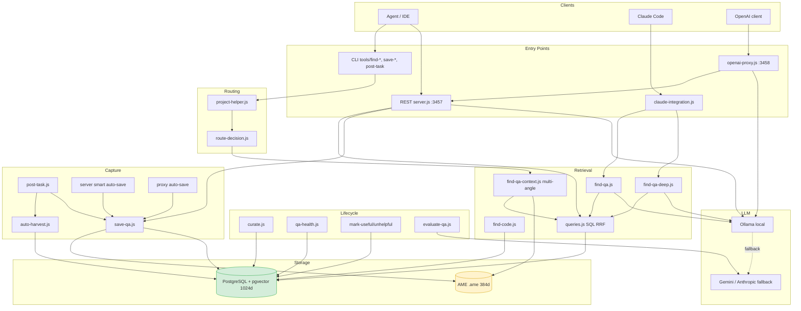

# Semantic Brain — Kiểm toán hiện trạng kiến trúc

- **Ngày kiểm toán:** 2026-10-30
- **Commit:** `77927b4` (fix(semantic): repair tag/migration SQL, honor dbPath, guard backups)
- **Phạm vi:** `E:\Tools\SemanticBrain` (Node.js + PostgreSQL/pgvector + AME), có tham chiếu dependency `E:\15. Other\AgentMemoryEngine`
- **Phương pháp:** đọc toàn bộ source; đo schema và dữ liệu thật trên PostgreSQL; `EXPLAIN (ANALYZE, BUFFERS)` cho query retrieval lõi; `AME inspect` và `AME query` trên container thật; không sửa source, không xóa dữ liệu.
- **Lưu ý:** số liệu dưới đây là snapshot **trước Phase 0**. Sau triển khai, xem [phase0-results.md](phase0-results.md).
- **Nguyên tắc phân loại:** một tính năng chỉ được coi là "đã triển khai" khi có đường đọc/ghi thực tế và có dữ liệu/đường gọi chứng minh. Class hoặc interface tồn tại nhưng không được nối vào luồng chính thì xếp "một phần" hoặc "chỉ trên giấy".

---

## 0. Kết luận điều hành

Semantic Brain hiện là một **knowledge cache + CLI retrieval tốt cho một dự án ERP duy nhất**, chưa phải một hệ thống memory đa tầng hay hybrid reasoning.

Ba câu quan trọng nhất:

1. **Nó đang chạy được và có dữ liệu thật:** 3.407 bản ghi QA, 69 MB, 83,9% đến từ đường `agent-direct`; progressive disclosure L0/L1 thực sự hữu ích cho agent.
2. **Nó đang có hai bộ nhớ không đồng bộ:** PostgreSQL 3.407 bản ghi (BGE-M3, 1024 chiều) và AME 3.871 bản ghi (MiniLM, 384 chiều), lệch 464 bản ghi, không có cơ chế đối soát. `save-qa.js` ghi cả hai ngay cả khi `MEMORY_BACKEND=postgres`.
3. **Chất lượng retrieval đang bị giới hạn bởi thiết kế, không phải bởi dữ liệu:** query lõi quét toàn bảng (Seq Scan 3.407 dòng, ~290 ms) và bỏ qua HNSW; bộ lọc project dùng `tags &&` (OR) nên rò rỉ tri thức giữa các dự án. Lần chạy thử `context-fetch` cho dự án `semanticbrain` trả về các bản ghi `project:erp` với độ khớp 40–74%.

Điểm mạnh lớn nhất là **kỷ luật CLI và progressive disclosure**. Điểm yếu lớn nhất là **không có mô hình tin cậy/provenance, không có project isolation thực sự, và không có vòng đo chất lượng**. Vì vậy hệ thống đang tích lũy kiến thức nhanh hơn khả năng kiểm chứng và làm sạch nó.

---

## 1. Hệ thống hiện tại là gì

### 1.1. Runtime topology

```
Agent / IDE / Claude Code
   │
   ├── CLI (50 file trong tools/, maintenance/)
   ├── REST :3457 (server.js)
   ├── OpenAI-compatible proxy :3458 (openai-proxy.js)
   └── claude-integration.js (gọi CLI con)
          │
          ▼
   Retrieval / Capture / Lifecycle
          │
          ├── PostgreSQL 16 + pgvector  (agent_qa_cache, agent_recipes, agent_registry,
          │                              agent_codebase_index, history, querylog, embedding cache)
          └── AME .ame single-file      (IPC \\.\pipe\ame_pipe, fallback CLI .exe)
          │
          ▼
   LLM: Ollama local (qwen2.5-coder:1.5b trong .env) → Gemini 2.5 Flash → Anthropic
```

### 1.2. Sự thật vận hành cần ghi nhận

| Hạng mục | Hiện trạng | Bằng chứng |
| :--- | :--- | :--- |
| Backend đang cấu hình | `MEMORY_BACKEND=postgres` | `.env` |
| Backend thực tế khi đọc | PostgreSQL (auto → postgres) | `tools/find-qa-context.js:113-123` |
| Backend thực tế khi ghi | **Cả PostgreSQL và AME** | `tools/save-qa.js:43-58` |
| Số bản ghi PostgreSQL | 3.407 | `SELECT count(*)` |
| Số bản ghi AME | 3.871 | `AME inspect data/semantic_brain.ame` |
| Chiều vector PostgreSQL | 1024 (BGE-M3) | `core/embed.js:17-18`, schema |
| Chiều vector AME | 384 (all-MiniLM-L6-v2, SQ8) | `AME inspect`; `storage-ame.js:66` |
| Mô hình AME | `all-MiniLM-L6-v2` | `dist/lite/models/all-MiniLM-L6-v2` |
| Graph trong AME | 16 node, **0 edge** | `AME inspect` |
| Test tự động | **Không có** | không có thư mục test, `package.json` không có script test |
| CI | **Không có** | không có workflow/config |

---

## 2. Sơ đồ kiến trúc hiện tại



**Điểm cần chú ý trong sơ đồ:**

- AME và PostgreSQL là hai nhánh ghi song song, không có transaction/outbox.
- `server.js` và `openai-proxy.js` chỉ dùng PostgreSQL; `find-qa-context.js` có thể dùng AME; `save-qa.js` ghi cả hai. Cùng một hệ thống nhưng mỗi entry point có semantics khác nhau.
- `find-code.js` là đường retrieval code duy nhất, nhưng `context-fetch` không gọi nó.

---

## 3. Luồng dữ liệu và luồng xử lý

### 3.1. Luồng đọc (pre-task)

```
Task description
  → project-helper.getProjectInfo()           (đọc .project-rule.md hoặc Git root)
  → route-decision.decideRoute()              (suy tag bằng regex + rules/shortcuts)
  → inferTechTags(git status)                 (suy tag từ file thay đổi)
  → find-qa-context:
       decomposeToQueries()                   (task + các angle trong decompose-angles.json)
       for each query:
           embed(query)                       (BGE-M3; memory LRU → DB cache → model)
           qaRankingQuery: vector + FTS + RRF + freshness + confidence + useful_count
       dedup theo id, cộng cross-RRF
       tăng hit_count cho top N
  → in L0 index hoặc full context
```

Điểm mạnh: nhiều angle + cross-RRF + progressive disclosure. Điểm yếu: mỗi angle là một query đầy đủ; 1 task có thể sinh 3–8 query, mỗi query ~290 ms, cộng embed; không có ngân sách token.

### 3.2. Luồng ghi (post-task)

Có **bảy kịch bản ghi** nhưng chỉ **ba implementation SQL** (`save-qa.js`, `auto-harvest.js`, `server.js handleSaveQA`) cùng một adapter AME trong `save-qa`:

| Đường ghi | Điều kiện | Dedup | Quality gate | Ghi AME | Confidence |
| :--- | :--- | :--- | :--- | :--- | :--- |
| `post-task.js --direct` → `save-qa.js` | Agent tự tổng hợp | hash + cosine ≥0.85 | regex transient + format | Có | 1.0 |
| `post-task.js` → `auto-harvest.js` | LLM trích xuất | chỉ hash | chỉ lọc theo prompt | **Không** | 0.9 |
| `save-qa.js` trực tiếp | Manual/agent | hash + cosine ≥0.85 | không | Có | tham số, mặc định 1.0 |
| `server /save-qa` | REST | chỉ hash | không | Không | luôn set 1.0 khi update |
| `openai-proxy` auto-save | Mọi câu trả lời kỹ thuật | hash + cosine | heuristic độ dài/từ khóa | Có | 0.5 |
| `server` SMART auto-save | answer >50 ký tự, top score >0.5 | hash + cosine | không | Có | 0.5, **không có project tag** |
| `find-qa` MISS → `auto-qa` | có `GEMINI_API_KEY`/`ANTHROPIC_API_KEY` | chỉ hash | không | Có (qua `save-qa`) | **1.0 mặc định** |

Hệ quả: cùng một câu hỏi có thể được lưu với confidence 1.0, 0.9 hoặc 0.5 tùy entry point; AME path không dedup; `auto-harvest` không ghi AME; `server` luôn nâng confidence lên 1.0 khi update.

### 3.3. Luồng đọc sâu (deep)

- `find-qa-deep.js`: đệ quy text → tìm reference bằng regex → query lại → tổng hợp bằng Ollama. **Không có visited set**, chỉ chặn bằng `MAX_DEPTH=3` (`tools/find-qa-deep.js:23-81`).
- `server.js` có bản deep thứ hai, có `visited` set (`server.js:233-331`), nhưng cú pháp reference khác (`(see QA #n)` vs `qa_id:n`).
- `find-qa-deep.js` sinh reference `qa_id:123` nhưng `findQADeep()` không xử lý prefix này; nó query như text thường (`tools/find-qa-deep.js:108-113`, `23-37`). Reference theo ID vì vậy không hoạt động.

### 3.4. Luồng học từ LLM

`openai-proxy.js` chặn completion, inject một bản ghi RAG nếu score ≥45, rồi ghi lại câu trả lời nếu có code hoặc câu hỏi kỹ thuật (`openai-proxy.js:34-75, 121-145`). Đây là **học không kiểm chứng**: output của model 1.5B được lưu với confidence 0.5 và có thể được retrieval ở lần sau. Không có bước xác thực compile/test/người dùng.

---

## 4. Kiểm toán từng thành phần

### 4.1. Memory Management

- **Vấn đề giải quyết:** lưu tri thức qua phiên, giảm lặp lại lỗi.
- **Cơ chế thực tế:** một bảng `agent_qa_cache` phẳng; mỗi dòng là một cặp Q/A; `tags` đóng vai trò domain/project/type; `agent_qa_history` lưu 33 bản ghi lịch sử.
- **Phụ thuộc:** PostgreSQL là nguồn chính; AME là bản sao thứ hai.
- **Trùng lặp:** 3 implementation ghi SQL + 1 adapter AME; 3 đường đọc; 2 bản deep retrieval.
- **Nghẽn:** không có mô hình working memory; không có session/task; không có episode/outcome; semantic memory chỉ là tag `pinned` (0 bản ghi); procedural memory 8 recipe, 0 success.
- **Giới hạn dữ liệu:** 3.407 dòng / 69 MB vẫn ổn, nhưng query O(N) (xem 4.5).
- **Nhất quán:** dual-write lệch 464 bản ghi; `backend=ame` có thể mất dữ liệu im lặng (xem 4.9).
- **Kết luận:** **một phần**. Có episodic phẳng; thiếu working, semantic thực chất, procedural thực chất, project isolation.

### 4.2. Semantic Search

- **Cơ chế:** vector cosine + PostgreSQL FTS `simple`, hợp nhất bằng RRF:
  `((1/(60+rank_vec)) + (1/(60+rank_fts))) * 30.5 * freshness + confidence*0.05 + useful_count*0.05` (`core/queries.js:33-59`).
- **Điểm mạnh:** RRF là lựa chọn đúng; có freshness và confidence; SQL tập trung một chỗ.
- **Điểm yếu:**
  - `tokens` vẫn được truyền nhưng **không còn dùng trong SQL** (`core/queries.js:65, 71-77`).
  - `minSimilarity` được nội suy vào SQL; nếu caller truyền giá trị lạ có thể thành lỗi/injection (`core/queries.js:47`).
  - `ts_rank_cd('simple', ...)` không xử lý tiếng Việt có dấu/stemming; query tiếng Việt và answer tiếng Việt thường lệch token.
  - Không có reranker, query expansion động, multi-hop trong pipeline chính.
  - `useful_count` gần như luôn 0 (tổng 1), nên thành phần này vô hiệu.
- **Đo thực tế:** `EXPLAIN ANALYZE` cho thấy **Seq Scan 3.407 dòng, 12.839 shared buffers, Execution Time 290 ms**, HNSW index `idx_qa_embedding_hnsw` không được dùng. Nguyên nhân: `RANK() OVER (...)` và filter `vector_similarity > 0.35` buộc tính similarity cho toàn bảng trước khi sort.
- **Kết luận:** **đã triển khai nhưng không scale**. Ở 3.4k dòng còn chấp nhận được; 50k dòng sẽ ~4–5 giây/query, nhân với 3–8 angle.

### 4.3. Embedding

- **Cơ chế:** `@xenova/transformers`, `Xenova/bge-m3`, quantized, pooling `cls`, normalize (`core/embed.js:39-55, 140-150`).
- **Cache:** LRU 50 entry trong process + bảng `agent_query_embedding_cache` (6.486 dòng, 37 MB), key MD5 của text lowercase (`core/embed.js:20-37, 60-117`).
- **Điểm mạnh:** local, multilingual, không cần API; cache DB giúp query lặp lại không phải load model.
- **Điểm yếu:**
  - `VECTOR(1024)` hardcode trong `ensureCacheTable`, trong khi `MODEL_DIMS` có thể cấu hình (`core/embed.js:65-69`).
  - Không có TTL/eviction cho DB cache; 6.486 dòng cho 3.407 bản ghi là dấu hiệu query biến thể tích lũy vô hạn.
  - `embed('')` trả vector 0 (`core/embed.js:125`), có thể tạo similarity rác.
  - Không có batch embedding; indexer embed tuần tự từng file (`tools/codebase-indexer.js:138-167`).
  - Mỗi process CLI mới phải load lại model nếu cache miss; proxy/server spawn `save-qa.js` cho mỗi lần lưu → mỗi lần lưu có thể load ~570 MB model.
- **Kết luận:** **đã triển khai**, nhưng vận hành chưa tối ưu cho máy 16 GB.

### 4.4. Vector Storage

- **PostgreSQL:** `agent_qa_cache` 69 MB; HNSW index tồn tại nhưng không được query lõi dùng; GIN tags/keywords có tồn tại.
- **AME:** single-file memory-mapped, 3.871 bản ghi, 384 chiều SQ8, 16 graph node / 0 edge.
- **Schema drift:** `maintenance/setup.js` **không tạo** các cột/bảng mà code đang dùng:
  - `useful_count` (được `core/queries.js:35,54`, `curate.js:32`, `qa-health.js:163`, `view-qa.js:66`, `mark-useful.js:44-46` dùng)
  - `agent_qa_querylog` (`server.js:43`, `find-qa.js:125`, `dashboard.js:27`)
  - `agent_codebase_index` (chỉ `codebase-indexer.js` tự tạo)
  - `agent_query_embedding_cache` (chỉ `embed.js` tự tạo)
  - các view `v_qa_dashboard`, `v_qa_quality`, `v_querylog_summary` (có trong DB thật, không có trong setup)
  - index `idx_qa_hit_count`, `idx_qa_embedding_hnsw` (có trong DB thật, không có trong setup)
- Hệ quả: **cài mới từ repo sẽ tạo schema thiếu; `/find-qa` và `curate` sẽ lỗi**. Đây là lỗi triển khai nghiêm trọng, không phải chi tiết nhỏ.
- **Định dạng lưu:** nội dung được nhét vào payload text + metadata JSON trong AME; PostgreSQL lưu cột riêng. Hai định dạng không có version/schema id.
- **Kết luận:** **một phần**. PostgreSQL là kho thật; AME là kho thử nghiệm chưa tương thích.

### 4.5. Knowledge Retrieval

- **Đường chính:** `find-qa-context` (multi-angle) → `qaRankingQuery`.
- **Đường khác:** `find-qa`, `find-qa-deep`, `/find-qa`, `/find-qa-deep`, proxy RAG, `claude-integration`.
- **Chunking:** không có. Đơn vị là toàn bộ answer (trung bình 265 ký tự, p50 234, max 1.962). Với tri thức dài, không có parent-child.
- **Code-aware:** `codebase-indexer` tạo summary cấp file bằng regex C# (`tools/codebase-indexer.js:72-118`): namespace, class, deps, tối đa 15 method. `find-code.js` đọc được, nhưng **không được nối vào `context-fetch`**. Không có chunk theo symbol/method.
- **Metadata filtering:** chỉ `tags`; không có filter theo source/time/confidence/status/project_id.
- **Knowledge graph:** chỉ là regex reference trong answer (`see:`, `refer to`, `(see QA #n)`); AME graph 0 edge. Không có entity extraction/relationship table.
- **Temporal:** chỉ freshness boost; không có `valid_from/valid_to`, không query theo thời gian.
- **Relationship traversal:** `find-qa-deep` đệ quy text; không có graph traversal thật.
- **Re-ranking:** không có.
- **Query expansion:** static `decompose-angles.json`, 14 angle, gắn chặt ERP/MDS/WinForms (`tools/decompose-angles.json`).
- **Retrieval confidence:** chỉ `final_score`; không có calibration, không có "không đủ tri thức".
- **MISS → sinh tri thức:** khi không tìm thấy, `find-qa.js` có thể gọi `auto-qa.js` để LLM suy luận câu trả lời, lưu bằng `save-qa.js` với **confidence mặc định 1.0**, rồi query lại và trả như HIT (`tools/find-qa.js:101-116`, `tools/auto-qa.js:10-30`). Đây là vòng tự tạo tri thức không kiểm chứng, chỉ kích hoạt khi có cloud key.
- **Kết luận:** **một phần**. Có hybrid vector+FTS và multi-angle; thiếu code retrieval trong luồng chính, rerank, temporal, graph, chunking.

### 4.6. Context Management

- **Đã có:** L0 index (1 dòng/bản ghi, preview 140 ký tự), L1 `view-qa`, `--full`; cross-angle dedup; giới hạn `--limit` (mặc định 8).
- **Chưa có:** token budgeting, compression, relevance threshold động, provenance trong output, conflict flags, context persistence, prioritization theo task type, chống trùng nội dung giữa các bản ghi.
- **Hệ quả:** `context-fetch` luôn lấy tối đa 8 bản ghi dù task đơn giản hay kiến trúc; không có ngân sách theo risk level mà `route-decision` đã tính.
- **Kết luận:** **một phần**. Progressive disclosure là điểm mạnh thực sự; context engineering còn thiếu phần định lượng.

### 4.7. LLM Integration

- **Đã có:** Ollama local (`qwen2.5-coder:1.5b-instruct-q4_K_M` trong `.env`), fallback Gemini 2.5 Flash, fallback Anthropic Claude 3 Opus; streaming; `askWithReasoning` tách `<thought_process>`.
- **Chưa có:** model registry/capability, routing theo độ phức tạp/chi phí, timeout, retry/backoff, circuit breaker, token accounting, structured output validation, redaction.
- **Lỗi cụ thể:**
  - `askLocal()` catch mọi lỗi rồi gọi `askCloud()`; `askLLM()` lại catch và gọi `askCloud()` lần nữa (`core/llm-local.js:43-45, 138-146`). Fallback lồng nhau, khó quan sát.
  - `fetch` không có timeout; Ollama treo sẽ treo request.
  - `askLocalStream` decode từng chunk và `split('\n')` không giữ buffer dòng dở (`core/llm-local.js:75-86`) → mất token khi JSON bị cắt qua chunk.
  - Model Anthropic hardcode `claude-3-opus-20240229` (`core/llm-local.js:124`), đã cũ.
- **Kết luận:** **một phần**. Có fallback local→cloud; chưa phải gateway.

### 4.8. Agent Workflow

- **Đã có:** `route-decision.js` sinh rules/skills/agents gợi ý, risk 1–5, dead-loop detection, execution mode; `context-fetch` và `auto-post-task` dùng nó.
- **Chưa có:** workflow điều phối retrieval → reasoning → verification → harvest; không có trạng thái task; không có checkpoint; không có vòng lặp "thiếu tri thức → truy xuất thêm".
- **Cụ thể:** `route-decision` chỉ dùng cho tag/rules, không điều khiển retrieval depth hay model choice. `execution_mode` được in ra nhưng không có consumer nào thực thi.
- **Kết luận:** **một phần**. Có router tĩnh; thiếu orchestrator.

### 4.9. Data Persistence

- **PostgreSQL:** nguồn chính; pool max 3 (`core/config.js:30`); mỗi CLI gọi `pool.end()`.
- **AME:** dual-write; `saveQA` trả `memoryId: 1` khi dùng CLI fallback (`core/storage-ame.js:342, 359`), nên `viewQA(id)` sau đó không tìm đúng bản ghi.
- **Mất dữ liệu im lặng:** nếu `MEMORY_BACKEND=ame` và AME không khả dụng, `save-qa.js` bỏ qua PostgreSQL và return (`tools/save-qa.js:51-58`) → không lưu ở đâu cả, chỉ warning.
- **Không nhất quán backend:** `auto-harvest.js` luôn ghi PostgreSQL (`tools/auto-harvest.js:146-178`), `server.js` luôn PostgreSQL, `save-qa.js` ghi cả hai. `MEMORY_BACKEND` không được tôn trọng thống nhất.
- **Backup:** có `data/backup/pg_backup_20261029.jsonl`, `semantic_brain.ame.20261029`, `unused_over90d_20261029.jsonl`; là thao tác thủ công, không có lịch.
- **Export:** `maintenance/export.js` bỏ `useful_count`, `embedding`, `search_text`, `question_hash`; không thể restore đầy đủ.
- **Kết luận:** **một phần**. Có persistence và backup thủ công; thiếu single source of truth và phục hồi đầy đủ.

### 4.10. Memory Update và Consolidation

- **Đã có:** dedup khi ghi (hash + cosine ≥0.85) trong `save-qa.js`; `agent_qa_history`; `curate` phát hiện stale/overlap; `qa-health` decay confidence; `mark-useful/unhelpful`.
- **Thực tế vận hành:**
  - 0 bản ghi `pinned`; 0 bản ghi `status:stale` → lifecycle chưa từng chạy.
  - 797 bản ghi chưa từng được dùng; 2.468 bản ghi cũ hơn 60 ngày (72%).
  - `useful_count` tổng = 1 → feedback "useful" gần như không được dùng.
  - `agent_recipes`: 8 bản ghi, 34 hit, **0 success** → `mark-recipe` chưa được gọi.
  - `agent_qa_history`: 33 bản ghi, không có version number/actor thật.
- **Chưa có:** consolidation/merge, contradiction detection, re-evaluation tự động, temporal validity, archive table, promotion semantic.
- **Vòng tự tạo:** `auto-qa` lưu câu trả lời LLM với confidence 1.0; `server` SMART lưu với 0.5 nhưng không có `project` tag. Đây là hai nguồn làm bẩn kho tri thức.
- **CLI/docs lệch:** README hướng dẫn `curate.js --archive-stale --days=60`, nhưng code chỉ hiểu `--mark-stale` và `--stale-days=60` (`README.md:129` vs `tools/curate.js:17-19`).
- **Kết luận:** **một phần**. Có công cụ audit; chưa có vòng đời tự động.

### 4.11. Metadata và Relationship

- **Tag system:** 2 tầng (`domain:`, `tech:`, `type:`, `pattern:`) + `project:` + `pinned` + `status:stale`; normalize qua `TAG_RULES` (`core/keywords.js:60-130`). Đây là điểm mạnh.
- **Nhưng:** `normalizeTags` chỉ map các tag có trong `TAG_RULES`; các tag tự do như `helpdesk`, `rd`, `erp` vẫn tồn tại (187, 155, 115 bản ghi) → tag vocabulary không được kiểm soát.
- **Relationship:** không có bảng edge; chỉ regex reference; `agent_recipes.registry_ids` tồn tại nhưng không được dùng trong retrieval.
- **Provenance:** `source`, `confidence_score`, `created_at`, `updated_at`, `tags`. Thiếu source URL/file/commit, verifier, scope, version, valid time.
- **Kết luận:** **một phần**. Metadata rẻ và hữu ích; relationship/provenance chưa đủ để tin cậy.

### 4.12. Error Handling

- **Đặc điểm:** rất nhiều `catch {}` rỗng: `core/embed.js:98-101, 114-116`, `core/storage-ame.js:204, 221-223, 266-286`, `server.js:42-45`, `tools/find-qa-context.js:191-193`, `tools/auto-harvest.js:86-100`.
- **Hệ quả:** retrieval trả 0 kết quả thay vì báo lỗi; DB cache hỏng không ai biết; AME lỗi bị coi là "không có dữ liệu".
- **Không có:** structured logging, correlation id, metrics, health check sâu, alert.
- **Kết luận:** **yếu**. Đây là nguyên nhân gốc khiến các lỗi schema/dual-store không được phát hiện.

### 4.13. Performance và Resource Management

| Chỉ số đo được | Giá trị | Ghi chú |
| :--- | :--- | :--- |
| Query lõi trên 3.407 dòng | **290 ms** | Seq Scan; HNSW không dùng |
| Số angle trung bình | 3–8 | `decompose-angles.json` |
| Chi phí retrieval/task | ~0,3–2,5 s (chưa tính LLM) | nhân theo angle |
| Embedding model | ~570 MB quantized, ~800 MB RAM/process | comment trong `core/embed.js:6-8` |
| Query embedding cache | 6.486 dòng / 37 MB | không TTL |
| QA cache | 3.407 dòng / 69 MB | |
| AME container | 50 MB, 3.871 bản ghi | |
| Pool DB | max 3 | `core/config.js:30` |
| Process khi lưu | server/proxy spawn `save-qa.js` | load model mỗi lần nếu cache miss |

- **Không có:** batch embedding, worker queue, lazy indexing, incremental code index, connection reuse giữa CLI, giới hạn body request.
- **Rủi ro triển khai:** `Dockerfile` dùng `node:20-alpine` trong khi `onnxruntime-node` thường cần glibc; embedding có thể fail trong container. Cần build và chạy thử trước khi dùng Docker làm môi trường chính. Dockerfile cũng dùng `npm install` thay vì `npm ci`, nên build không reproducible.
- **Kết luận:** **một phần**. Chạy được trên 16 GB nhưng lãng phí RAM/CPU do mô hình process và spawn.

### 4.14. Extensibility

- **Điểm tốt:** `core/config.js`, `core/queries.js`, `core/keywords.js`, `core/index.js` là các seam rõ ràng; CLI tách khỏi server.
- **Điểm xấu:**
  - Không có interface cho storage/embedding/LLM; muốn đổi provider phải sửa code trực tiếp.
  - Đường dẫn tuyệt đối hardcode ở nhiều nơi: `core/config.js:50`, `core/storage-ame.js:22-24, 69`, `maintenance/setup.js:15-17`, `tools/codebase-indexer.js:23-26`, `tools/route-decision.js:20-27`, `tools/claude-integration.js` (comment).
  - `maintenance/setup.js` tính `PROJECT_ROOT` lên 4 cấp — chỉ đúng khi repo nằm trong `.agent/tools/semantic/maintenance` của ERP, sai khi đứng độc lập (`maintenance/setup.js:14-17`).
  - `AGENT_ROOT=E:\00.ERP\ERP\.agent` trong `.env` → `find-skill` chỉ có nghĩa với ERP.
- **Kết luận:** **yếu**. Repo chưa portable, chưa có plugin seam.

---

## 5. Ma trận độ trưởng thành tính năng

| # | Năng lực | Trạng thái | Bằng chứng chính |
| :--- | :--- | :--- | :--- |
| 1 | Hybrid vector + FTS (RRF) | **Đã triển khai** | `core/queries.js:33-59` |
| 2 | Multi-angle retrieval | **Đã triển khai** | `tools/find-qa-context.js:98-111` |
| 3 | Progressive disclosure L0/L1 | **Đã triển khai** | `find-qa-context.js:219-241`, `view-qa.js` |
| 4 | Write-time dedup (hash + 0.85) | **Đã triển khai** (chỉ PG) | `save-qa.js:72-131` |
| 5 | Harvest quality guard | **Đã triển khai** | `post-task.js:68-116` |
| 6 | Tag normalization 2 tầng | **Đã triển khai** | `keywords.js:60-130` |
| 7 | Local embedding + cache | **Đã triển khai** | `embed.js:39-157` |
| 8 | Local LLM + cloud fallback | **Đã triển khai** | `llm-local.js:19-146` |
| 9 | OpenAI-compatible proxy | **Đã triển khai** | `openai-proxy.js` |
| 10 | CLI suite + export/import | **Đã triển khai** | `tools/`, `maintenance/` |
| 11 | Codebase semantic index | **Một phần** (có writer/reader riêng, không nối luồng chính) | `codebase-indexer.js`, `find-code.js` |
| 12 | AME storage adapter | **Một phần** (khác embedder, fake ID, không dedup, không tag server-side) | `storage-ame.js` |
| 13 | Lifecycle curation | **Một phần** (thủ công, 0 pinned, 0 stale) | `curate.js`, `qa-health.js` |
| 14 | Deep retrieval | **Một phần** (2 bản trùng, reference ID hỏng) | `find-qa-deep.js`, `server.js:233-331` |
| 15 | Multi-tenancy/project isolation | **Một phần** (tag OR, không enforce) | `queries.js:29`, `find-qa-context.js:55-74` |
| 16 | Context engineering | **Một phần** (L0 tốt, thiếu budget/compression/provenance) | `find-qa-context.js:219-241` |
| 17 | Routing theo task/model | **Một phần** (chỉ risk/tag; không route model) | `route-decision.js:283-382` |
| 18 | Working memory | **Chưa có** | không có session/task store |
| 19 | Semantic memory (verified facts) | **Chưa có** (chỉ tag `pinned`, 0 dòng) | DB count |
| 20 | Procedural memory | **Chưa có thực chất** (8 recipe, 0 success) | DB count |
| 21 | Knowledge provenance/trust | **Chưa có** (source + confidence thủ công) | schema |
| 22 | Conflict detection | **Chưa có** | không có code |
| 23 | Consolidation/merge | **Chưa có** (chỉ báo overlap) | `curate.js:89-112` |
| 24 | Temporal validity/versioning | **Chưa có** (chỉ history 33 dòng) | schema |
| 25 | Model gateway/routing | **Chưa có** (local→cloud tuyến tính) | `llm-local.js` |
| 26 | Verification pipeline | **Chưa có** | không có code |
| 27 | Evaluation/benchmark chất lượng | **Chưa có** (chỉ latency/token ước lượng) | `benchmark.js`, `benchmark-pg-vs-ame.js` |
| 28 | Auth/rate limit/security | **Chưa có** | `server.js`, `openai-proxy.js` |
| 29 | MCP/SDK | **Chưa có** (AME có MCP riêng, Semantic Brain không) | `AgentMemoryEngine.Cli.exe --help` |
| 30 | Automated tests/CI | **Chưa có** | repo scan |

---

## 6. Baseline đo được (dùng cho roadmap)

### 6.1. Dữ liệu

| Chỉ số | Giá trị |
| :--- | :--- |
| Tổng QA | 3.407 |
| Kích thước bảng QA | 69 MB |
| Độ dài answer trung bình / p50 / max | 265 / 234 / 1.962 ký tự |
| QA chưa từng được retrieve | 797 (23,4%) |
| QA cũ hơn 60 ngày | 2.468 (72,4%) |
| QA có tag `pinned` | 0 |
| QA có tag `status:stale` | 0 |
| Tổng `useful_count` | 1 |
| Lịch sử thay đổi | 33 dòng |
| Query log | 124 dòng (2026-04-17 → 2026-10-30) |
| Embedding cache | 6.486 dòng / 37 MB |
| Recipe | 8 (34 hit, 0 success) |
| Registry skill/workflow | 21 / 15 |
| Code index | 475 file, 6 loại |
| Cặp gần trùng ≥0.95 | 5 |

### 6.2. Phân bố nguồn

| Source | Số bản ghi | Tỷ lệ | Confidence TB | Hit |
| :--- | ---: | ---: | ---: | ---: |
| `agent-direct` | 2.860 | 83,9% | 0,91 | 15.471 |
| `auto-harvest` | 407 | 11,9% | 0,70 | 777 |
| `teach` | 48 | 1,4% | 0,99 | 1.278 |
| `seed` | 45 | 1,3% | 0,99 | 985 |
| `reviewed-agent` | 22 | 0,6% | 1,00 | 210 |
| `manual` | 17 | 0,5% | 0,93 | 80 |
| `atomic-split` | 5 | 0,1% | 0,84 | 12 |
| `agent-session` | 3 | 0,1% | 0,95 | 15 |

### 6.3. Phân bố project

| Project tag | Số bản ghi |
| :--- | ---: |
| `project:erp` | 2.780 (81,6%) |
| `project:zero_universe` | 85 |
| `project:zeroagent` | 69 |
| `project:mds` | 18 |
| `project:syncdb` | 8 |
| `project:mms` | 7 |
| `project:zerovector` | 6 |
| `project:backgroundswitch` | 4 |
| `project:zeroui` | 4 |
| `project:agentic-core` | 3 |
| còn lại | ≤2 mỗi project |

Hệ thống được thiết kế "multi-tenant bằng tag" nhưng thực tế là **single-tenant ERP + vài project thử nghiệm**. Đây là dữ liệu quan trọng để quyết định đầu tư: tối ưu cho ERP trước, nhưng không được khóa kiến trúc vào ERP.

### 6.4. Retrieval

| Kịch bản | Kết quả |
| :--- | :--- |
| `EXPLAIN ANALYZE` query lõi | Seq Scan 3.407 dòng; 12.839 shared buffers; **290 ms** |
| HNSW index | Có (`idx_qa_embedding_hnsw`) nhưng **không được dùng** |
| `context-fetch` cho task kiến trúc Semantic Brain | 8 kết quả; top 40–74%; nhiều bản ghi `project:erp`/`agentic-core` không liên quan |
| AME query tiếng Việt "deadlock ... inventory" | top 5 gồm `project:mds`, `project:erp`, `global`; `recencyRetention ≈ 7,8e-6`; `graphProximity=0` |

### 6.5. Chất lượng AME

- **Embedder khác:** MiniLM-L6-v2 (384, English-centric) vs BGE-M3 (1024, multilingual). Nội dung tri thức phần lớn là tiếng Việt; MiniLM là lựa chọn yếu hơn rõ rệt.
- **Recency gần như bằng 0:** trong 5 kết quả đo được, mọi bản ghi có `recencyRetention ~ 7,8e-6`, tức thành phần 15% trọng số gần như không đóng góp. `accessFrequency=1` cho cả 5 bản ghi vì retrieval không gọi `touch`.
- **Graph vô dụng:** 16 node, 0 edge; `graphProximity=0` cho mọi kết quả.
- **Importance/confidence gần như hằng số:** trong mẫu đo, 80–90 / 100 cho phần lớn bản ghi.
- Kết luận: "cognitive scoring" trong AME hiện thực chất là **vector similarity + hằng số**; chưa đủ để coi là một memory engine đa tầng.

---

## 7. Điểm mạnh

1. **Progressive disclosure đúng nhu cầu agent.** L0 index 1 dòng/bản ghi + L1 view giúp tiết kiệm context; đây là điểm khác biệt thực sự so với RAG thông thường.
2. **CLI-first, dễ dùng trong agent loop.** `context-fetch` / `post-task` là hai lệnh duy nhất cần nhớ; hỗ trợ `--dry-run`, `--direct`.
3. **Write-time dedup và history.** Hash + cosine ≥0.85 + `agent_qa_history` là nền tảng tốt để mở rộng thành consolidation.
4. **Quality guard cho harvest.** Regex chặn VPN/token/disk full/tool-broken là kinh nghiệm vận hành có giá trị, tránh đầu độc bộ nhớ bằng lỗi môi trường.
5. **Tag 2 tầng có prefix.** `domain:`, `tech:`, `type:`, `pattern:` cho phép lọc rẻ và mở rộng.
6. **Local-first.** BGE-M3 + Ollama + cache DB giúp hệ thống vẫn chạy khi cloud không có.
7. **SQL tập trung.** `core/queries.js` gom scoring vào một chỗ, dễ thay bằng pipeline mới.
8. **OpenAI proxy thực dụng.** Bất kỳ client OpenAI-compatible nào cũng dùng được mà không sửa code.
9. **Dữ liệu thật đủ lớn để học.** 3.407 bản ghi, 15k hit, 81% ERP — đủ để đo cải tiến, không cần giả lập.
10. **Backup/export tồn tại.** Có thể di chuyển dữ liệu và tạo baseline trước khi refactor.

---

## 8. Technical debt (ưu tiên theo mức độ chặn)

| ID | Nợ kỹ thuật | Ảnh hưởng | Bằng chứng |
| :--- | :--- | :--- | :--- |
| TD-01 | Schema drift: setup thiếu `useful_count`, `querylog`, view, index | Cài mới hỏng query lõi | `maintenance/setup.js:46-194` vs DB thật |
| TD-02 | Dual-store/dual-embedder không đồng bộ | 464 bản ghi lệch; retrieval khác nhau tùy backend | PG 3.407 vs AME 3.871; 1024 vs 384 |
| TD-03 | Query lõi không dùng ANN, O(N) | 290 ms ở 3.4k; không scale | `EXPLAIN`; `queries.js:33-59` |
| TD-04 | Project isolation không enforce | Rò rỉ tri thức giữa project | `queries.js:29`; context-fetch run |
| TD-05 | Nhiều đường ghi với nhiều bộ luật khác nhau | Confidence/dedup/quality không nhất quán | `save-qa`, `auto-harvest`, `server`, `proxy`, `auto-qa` |
| TD-06 | `hit_count` tăng khi retrieve, `useful_count` chết | Rich-get-richer; tín hiệu chất lượng sai | `server.js:39`; DB useful=1 |
| TD-07 | Không có trust/provenance | LLM output thành "fact"; `auto-qa` lưu 1.0 | `server.js:184`; `auto-qa.js:25`; proxy 0.5 |
| TD-08 | Lifecycle chưa từng chạy | 72% bản ghi cũ; 797 chưa dùng | DB counts; 0 pinned/stale |
| TD-09 | Không test/CI; benchmark chỉ latency | Không biết thay đổi tốt hay xấu | repo scan |
| TD-10 | Không auth/rate limit; body không giới hạn; CORS * | Poisoning, DoS, lộ tri thức | `server.js:337-430`; `openai-proxy.js:77-86` |
| TD-11 | Hardcode đường dẫn/ERP | Không portable; setup/benchmark sai | `setup.js:14-17`; `benchmark.js:13-15`; `config.js:50` |
| TD-12 | Nuốt lỗi (`catch {}`) | Sự cố im lặng | nhiều file |
| TD-13 | Spawn process cho mỗi lần lưu | RAM/CPU tăng; chậm | `server.js:80-85`; `proxy:62-73` |
| TD-14 | Deep retrieval trùng + reference ID hỏng | Kết quả sai/không đệ quy được | `find-qa-deep.js:108-113`; `server.js` bản 2 |
| TD-15 | Embedding cache không TTL | 6.486 dòng/37 MB tăng vô hạn | `embed.js:60-117` |
| TD-16 | AME `backend=ame` mất dữ liệu im lặng | Data loss | `save-qa.js:51-58` |
| TD-17 | LLM streaming parse lỗi; không timeout | Mất token/treo | `llm-local.js:75-86` |
| TD-18 | README lệch thực tế ("sub-50ms", `--archive-stale`) | Kỳ vọng sai, lệnh chạy sai | README vs EXPLAIN; `README.md:129` vs `curate.js:17-19` |
| TD-19 | Code index không nối vào retrieval | Đầu tư 475 file nhưng không dùng | `find-code.js` không được gọi |
| TD-20 | Tag vocabulary không kiểm soát | Filter/noise | DB tag `helpdesk`, `rd`, `erp` |

---

## 9. Những giới hạn phải giải quyết

1. **Giới hạn scale:** query O(N) và multi-angle nhân chi phí; mục tiêu 50k–100k bản ghi cần ANN-first + candidate budget.
2. **Giới hạn tin cậy:** không phân biệt quan sát/giả thuyết/suy luận/fact; không có kiểm chứng; không có conflict detection.
3. **Giới hạn đa dự án:** tag OR + thiếu `project_id`; không thể bảo đảm "không trộn tri thức".
4. **Giới hạn ngữ nghĩa:** FTS `simple` + MiniLM cho AME không phù hợp tiếng Việt; chunk theo Q/A không theo code/section.
5. **Giới hạn vận hành:** không auth, không metrics, không test, không migration, không portable.
6. **Giới hạn suy luận:** không có orchestrator, không có model routing, không có verification; LLM chỉ là "trả lời" hoặc "trích xuất".
7. **Giới hạn tài nguyên:** mỗi process load model; spawn-per-save; cache không giới hạn.
8. **Giới hạn tiến hóa:** không consolidation, không temporal versioning, không promotion semantic.

---

## 10. Đánh giá tổng thể cuối cùng

### 10.1. Mười vấn đề quan trọng nhất

1. **Hai kho tri thức không đồng bộ** (PG 3.407 / AME 3.871; BGE-M3 1024 / MiniLM 384) không có nguồn sự thật duy nhất.
2. **Project isolation không được enforce** — `tags &&` là OR; tri thức ERP lọt vào project khác.
3. **Retrieval O(N), bỏ qua HNSW** — 290 ms/query ở 3.4k dòng, không scale.
4. **Không có mô hình tin cậy/provenance** — output LLM 1.5B được lưu và retrieve như tri thức; `auto-qa` còn gán confidence 1.0 cho câu trả lời sinh khi MISS.
5. **Không có kiểm chứng/conflict detection** — không biết tri thức nào đúng, mâu thuẫn, lỗi thời.
6. **Schema drift làm hỏng cài mới** — setup thiếu cột/bảng/view mà code phụ thuộc.
7. **Nhiều đường ghi không nhất quán** — confidence, dedup, quality gate khác nhau.
8. **Feedback loop sai** — `hit_count` tăng khi retrieve; `useful_count` gần như không dùng.
9. **Lifecycle chưa vận hành** — 72% bản ghi cũ, 0 pinned, 0 stale, không consolidation.
10. **Không có test/CI/observability/security** — không thể chứng minh cải tiến, dễ sự cố im lặng.

### 10.2. Mười cải tiến có giá trị cao nhất

1. **Chọn PostgreSQL làm single source of truth; dừng dual-write; AME chỉ là adapter thử nghiệm read-only.**
2. **Thêm `project_id` + `scope` và một predicate bắt buộc trong mọi query; bỏ lọc OR bằng tag.**
3. **ANN-first retrieval:** `ORDER BY embedding <=> $1 LIMIT k` trước, rồi FTS/RRF/rerank; đặt budget candidate.
4. **Unified KnowledgeWriter:** một đường ghi duy nhất với dedup, trust level, provenance, quality gate.
5. **Trust model:** observation / hypothesis / inference / verified_fact / user_decision; model chỉ được ghi 2 mức đầu.
6. **Working memory + session:** bảng `memory_session` TTL ngắn, checkpoint, promote sang episodic khi xong.
7. **Provenance bắt buộc:** source type/id, verifier, scope, version, valid time, embedding model.
8. **Consolidation engine:** cluster gần trùng, merge có kiểm soát, giữ history, không merge cross-project.
9. **Evaluation harness:** golden set, precision@k/recall/nDCG, context token efficiency, conflict rate, latency/cost, A/B có/không memory.
10. **Security & vận hành:** auth token, rate limit, body limit, audit log, structured metrics, migration/CI.

> Chi tiết thiết kế đích: [target-architecture.md](target-architecture.md). Chi tiết memory: [memory-system.md](memory-system.md). Chi tiết suy luận: [hybrid-reasoning.md](hybrid-reasoning.md). Cách xử lý từng sự cố: [remediation-plan.md](remediation-plan.md). Lộ trình: [implementation-roadmap.md](implementation-roadmap.md).
