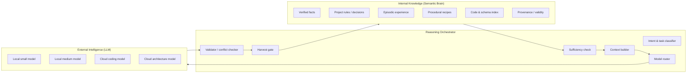

# Semantic Brain — Hybrid Intelligence và Reasoning Orchestration

Mục tiêu của tài liệu này: biến Semantic Brain từ **bộ nhớ bị động** (agent gọi `find-qa`, LLM tự xử lý) thành **bộ điều phối suy luận có kiểm chứng**, trong đó tri thức nội bộ và LLM bên ngoài phối hợp theo vai trò, không thay thế nhau.

Nguyên tắc:

> LLM là bộ máy suy luận có thể thay thế. Semantic Brain là hệ thống tri thức, ngữ cảnh và bằng chứng tích lũy. Kết quả LLM không mặc nhiên trở thành tri thức.

---

## 1. Hiện trạng

### 1.1. Những gì đã có

| Thành phần | Hiện trạng | File |
| :--- | :--- | :--- |
| Local LLM | Ollama, model từ `.env` (`qwen2.5-coder:1.5b-instruct-q4_K_M`) | `core/llm-local.js:19-46` |
| Cloud fallback | Gemini 2.5 Flash → Anthropic Claude 3 Opus | `core/llm-local.js:106-133` |
| Deep reasoning | Prompt ép `<thought_process>` rồi tách kết quả | `core/llm-local.js:152-177` |
| Retrieval | Vector + FTS + RRF, multi-angle | `core/queries.js`, `tools/find-qa-context.js` |
| Routing tĩnh | Risk 1–5, dead-loop, rules/skills/agents | `tools/route-decision.js` |
| Proxy | Inject 1 bản ghi RAG, auto-harvest | `openai-proxy.js` |
| Deep QA | Đệ quy reference text rồi tổng hợp | `tools/find-qa-deep.js` |

### 1.2. Những gì chưa có

- **Không có orchestrator:** mỗi entry point tự quyết định retrieval depth, prompt, model, có/không harvest.
- **Không có đánh giá độ đầy đủ của context:** nếu retrieval trả 0 hoặc trả rác, hệ thống vẫn gọi LLM và trả lời.
- **Không có phân biệt "biết" và "không biết":** không có unknown detection.
- **Không có kiểm chứng:** output LLM được lưu (proxy/server) mà không compile/test/review.
- **Không có conflict detection:** không so kết quả LLM với tri thức nội bộ.
- **Không có model routing:** luôn Ollama trước, cloud sau; không dựa trên độ phức tạp/chi phí.
- **Không có timeout/retry/circuit breaker/token accounting:** `fetch` không timeout; fallback lồng nhau.
- **Không có session:** không biết task đang ở bước nào, đã truy xuất gì, còn thiếu gì.

### 1.3. Hệ quả

- Câu trả lời có thể đúng ngẫu nhiên nhưng không có bằng chứng.
- Tri thức sai được lưu với confidence 0.5–1.0 và tái sử dụng.
- Không đo được "Semantic Brain có giúp LLM tốt hơn không".
- Không thể chọn model rẻ hơn cho tác vụ đơn giản vì không có Classification/Router.

---

## 2. Kiến trúc suy luận đích

### 2.1. Vai trò hai nguồn năng lực



**Phân công:**

| Việc | Internal | External |
| :--- | :--- | :--- |
| Nhớ quyết định, quy ước, lỗi cũ | **Chính** | Hỗ trợ |
| Xác định phạm vi, project, version | **Chính** | Không |
| Truy xuất code/schema/evidence | **Chính** | Không |
| Suy luận nhiều bước, thiết kế | Hỗ trợ | **Chính** |
| Viết/sửa code phức tạp | Hỗ trợ | **Chính** |
| Kiểm tra cú pháp, compile, test | **Chính** (deterministic) | Hỗ trợ |
| Phát hiện mâu thuẫn | **Chính** (rule + similarity) | Hỗ trợ (classifier) |
| Tổng hợp, diễn giải | Hỗ trợ | **Chính** |

### 2.2. Reasoning workflow

```
1. Nhận request
2. Chuẩn hóa + phân loại intent (question | task | refactor | bug | architecture | lookup)
3. Xác định project, scope, risk, ràng buộc
4. Mở/tái sử dụng Working Memory session
5. Truy xuất nội bộ vòng 1:
     - recipe (nếu task)
     - semantic facts + project decisions
     - episodic cùng error/task
     - code/schema index (nếu task code)
6. Đánh giá độ đầy đủ (coverage):
     - có item trực tiếp trả lời? có evidence? có mâu thuẫn?
     - thiếu gì? (file, schema, decision, version)
7. Nếu thiếu và còn budget: truy xuất vòng 2 (mở rộng theo dependency/edge), tối đa 2 vòng
8. Xây context có cấu trúc + token budget
9. Chọn model theo task/risk/context/cost
10. Gọi LLM với context + chỉ dẫn trích dẫn
11. Validate:
     - cú pháp/compile/test nếu là code
     - đối chiếu internal facts
     - phát hiện mâu thuẫn
12. Nếu mâu thuẫn/không đủ: yêu cầu làm rõ hoặc truy xuất thêm (tối đa 1 lần)
13. Trả kết quả kèm citations + confidence + unknowns
14. Harvest gate: chỉ lưu nếu đủ điều kiện (xem §7)
15. Cập nhật session; đóng/promote
```

Không phải mọi request đi hết 15 bước. **Adaptive routing** quyết định bỏ qua bước nào:

| Loại request | Bước bắt buộc | Bỏ qua |
| :--- | :--- | :--- |
| Lookup đơn giản ("X là gì?") | 1–6, 8, 13 | LLM nếu retrieval confidence cao; validation sâu |
| Task code nhỏ | 1–6, 8–11, 13–15 | Multi-hop, cloud nếu local đủ |
| Bug/regression | 1–6, 8–12, 14–15 | Không bỏ validation |
| Refactor/architecture | 1–15 | Không bỏ |
| Câu hỏi ngoài phạm vi | 1–3, 13 | Không gọi LLM; trả "không biết" |

---

## 3. Adaptive Model Routing

### 3.1. Tín hiệu đầu vào

| Tín hiệu | Nguồn | Dùng cho |
| :--- | :--- | :--- |
| Task type | classifier rule/local model | Chọn model family |
| Risk level (1–5) | `route-decision.js` | Model mạnh cho risk ≥4 |
| Context size (token) | Context builder | Model có context window phù hợp |
| Số module/file liên quan | retrieval metadata | Multi-file → cloud |
| Có code/schema không | retrieval | Code → model code |
| Yêu cầu độ chính xác | user/task | Verification bắt buộc |
| Latency budget | caller | Local nếu budget thấp |
| Cost budget | config | Local nếu cost thấp |
| Model health | health checker | Fallback |
| Offline mode | config | Local only |

### 3.2. Bảng routing mặc định

| Nhiệm vụ | Model | Lý do | Fallback |
| :--- | :--- | :--- | :--- |
| Phân loại intent/tag | Rule + local 0.5B | Rẻ, nhanh, deterministic | Rule only |
| Embedding | BGE-M3 local | Không cần LLM | Không |
| Tóm tắt ngắn < 2k token | Local 1.5B | Đủ chất lượng | Local 3B |
| Trích xuất Q/A | Local 3B + schema | Cần JSON ổn định | Cloud |
| Lookup/QA đơn giản | Retrieval-only | Không cần generate | Local 1.5B |
| Viết code/refactor | Cloud coding model | Chất lượng code | Local 7B nếu đủ RAM; nếu không, trả retrieval + đề xuất |
| Phân tích kiến trúc | Cloud mạnh | Multi-step | Cloud coding |
| Kiểm tra logic | Deterministic validator | Không thể hallucinate | Cloud judge (optional) |
| Dịch/format | Local 1.5B | Rẻ | Cloud |
| Tổng hợp multi-hop | Cloud | Context lớn | Local 3B + citations |

### 3.3. Quy tắc

- **Không dùng cloud chỉ vì có thể.** Mặc định local; escalate khi có tín hiệu cụ thể.
- **Escalation phải có lý do ghi log:** `reason=risk4|multi_file|context_overflow|local_failed`.
- **Không fallback mù:** nếu local trả kết quả kém (validation fail), mới escalate; không escalate ngay từ đầu.
- **Structured output:** mọi bước cần JSON phải dùng schema + validate; nếu fail, retry 1 lần với prompt sửa lỗi, rồi fallback model.
- **Offline:** nếu không có cloud, chỉ dùng local + retrieval; trả `degraded=true` và danh sách điều không thể làm.

---

## 4. Model Gateway

Hiện tại `llm-local.js` trộn ba việc: gọi Ollama, fallback cloud, và reasoning prompt. Cần tách thành gateway.

### 4.1. Interface

```js
// core/gateway/index.js
export interface ModelProvider {
  id: string;                       // 'ollama', 'openai', 'gemini', 'anthropic'
  capabilities: {
    chat: boolean;
    json: boolean;
    tools: boolean;
    streaming: boolean;
    maxContext: number;
  };
  costPer1kIn: number;              // 0 cho local
  costPer1kOut: number;
  health(): Promise<Health>;
  chat(req: ChatRequest, signal: AbortSignal): Promise<ChatResponse>;
  stream(req: ChatRequest, signal: AbortSignal): AsyncIterable<Token>;
}
```

`ChatRequest` chuẩn hóa: `messages`, `system`, `temperature`, `maxTokens`, `responseSchema`, `timeoutMs`, `metadata` (task type, project, trace id).

### 4.2. Thành phần

| Thành phần | Trách nhiệm |
| :--- | :--- |
| `ProviderRegistry` | Đăng ký provider, capability, cost, priority |
| `Router` | Chọn provider/model theo bảng §3 |
| `HealthChecker` | Ping định kỳ; đánh dấu unhealthy |
| `CircuitBreaker` | Mở sau N lỗi liên tiếp; half-open sau cooldown |
| `RetryPolicy` | Retry idempotent, backoff có jitter; không retry 4xx |
| `TokenAccountant` | Đếm input/output token, cost theo project/task |
| `ResponseValidator` | JSON schema, compile/test hook, citation check |
| `TraceLogger` | Log prompt/response đã redact, latency, model, reason |

### 4.3. Timeout/retry mặc định

| Provider | Connect | Read | Retry | Ghi chú |
| :--- | ---: | ---: | ---: | :--- |
| Ollama local | 2 s | 60 s | 1 | Stream có thể lâu |
| Cloud chat | 5 s | 90 s | 2 | Backoff 1s/3s |
| Embedding local | 5 s | 30 s | 2 | Model load lần đầu lâu |

- Mọi request phải có `AbortController`; hủy khi client disconnect.
- Streaming phải buffer dòng chưa hoàn chỉnh (sửa lỗi hiện tại `llm-local.js:75-86`).
- Ghi `degraded=true` khi phải fallback.

### 4.4. Structured output

- JSON phải validate bằng schema (Ajv hoặc Zod).
- Nếu sai: sửa 1 lần với thông báo lỗi; nếu vẫn sai, trả lỗi có kiểu, không lưu.
- Không parse JSON bằng regex/`replace('```')`; dùng schema validator trong `core/normalizer.js`.

### 4.5. Cost & observability

- Log mỗi call: `trace_id`, `project_id`, `task_type`, `model`, `tokens_in`, `tokens_out`, `cost`, `latency_ms`, `retry`, `fallback`, `validation`.
- Dashboard: cost/task, local/cloud ratio, failure rate, P95 latency.
- Không log nội dung nhạy cảm; redact key/token/path theo config.

---

## 5. Internal knowledge vs External output

### 5.1. Thứ tự ưu tiên khi trả lời

1. `user_decision` trong cùng project.
2. `verified_fact` trong cùng project, còn hiệu lực.
3. `verified_fact` global.
4. `episodic` cùng project, outcome success, còn mới.
5. `procedural` active, success rate cao.
6. `inference`/`hypothesis` (gắn nhãn rõ).
7. LLM generation (nếu chưa có internal).
8. "Không biết" + câu hỏi làm rõ.

Không được để LLM ghi đè mức 1–3. Nếu LLM mâu thuẫn, hiển thị cả hai + conflict.

### 5.2. Conflict resolution

| Tình huống | Hành động |
| :--- | :--- |
| LLM vs `user_decision` | Giữ user decision; gắn cảnh báo; không sửa |
| LLM vs `verified_fact` | Kiểm tra evidence; nếu LLM có evidence mới, tạo conflict + review; nếu không, giữ fact |
| Hai `verified_fact` mâu thuẫn | Tạo conflict; không tự chọn; ưu tiên cái mới hơn nếu có `valid_from` |
| Episodic cũ vs fact mới | Fact thắng; episodic giữ làm lịch sử |
| Global vs project | Project thắng trong project; global chỉ fallback |

### 5.3. Evidence và citation

- Mỗi câu trả lời dùng internal knowledge phải kèm `citations: [{id, title, trust_level, valid_from}]`.
- LLM được yêu cầu chỉ dùng context được cấp; nếu context không đủ, trả `insufficient_context`.
- Không trả lời bằng kiến thức nền của model khi câu hỏi là project-specific mà không có citation — trừ khi đánh dấu `external_knowledge=true`.

---

## 6. Retrieval sufficiency và unknown detection

### 6.1. Coverage check

Sau vòng retrieval, tính:

| Tín hiệu | Cách đo | Ngưỡng |
| :--- | :--- | :--- |
| Top score | `final_score` | < 0.35 → thiếu |
| Số item chất lượng | trust ≥ verified hoặc score ≥0.5 | 0 → thiếu |
| Có item trả lời trực tiếp | classifier yes/no | no → thiếu |
| Có evidence code/schema | có `source_ref`/`file` | task code mà không có → thiếu |
| Có conflict | `memory_conflict` open | >0 → cần làm rõ |
| Project coverage | tất cả item cùng project/global | khác project → loại |

### 6.2. Hành động

- **Đủ:** gọi LLM với context + citation; hoặc trả retrieval-only nếu lookup.
- **Thiếu nhẹ:** mở rộng query (angle thứ 2), tối đa 2 vòng.
- **Thiếu nặng:** trả `status: insufficient_knowledge`, liệt kê what_is_missing, đề xuất nguồn cần đọc; **không bịa**.
- **Conflict:** trả cả hai quan điểm + yêu cầu user quyết định.

### 6.3. Không dùng LLM để "đoán" khi thiếu

Đây là điểm khác biệt giữa memory system và chatbot. Trả "không biết" là hành vi đúng.

---

## 7. Harvest gate (chỉ lưu khi đủ điều kiện)

### 7.1. Phân loại đầu ra

| Nguồn | Trust tối đa | Điều kiện |
| :--- | :--- | :--- |
| Proxy/LLM completion | `observation` | Agent phải submit atoms; proxy không tự ghi |
| Agent-provided atoms (`ingest-knowledge`) | `hypothesis` / `verified_fact` | Schema hợp lệ; evidence nếu verified |
| `post-task --direct` | `hypothesis` | Có symptom/cause/fix |
| `post-task` + compile/test evidence | `verified_fact` | Evidence ref bắt buộc |
| User xác nhận | `user_decision` | Qua API/CLI explicit |
| Import/seed | `verified_fact` | Có source; review định kỳ |

### 7.2. Điều kiện lưu

1. Không transient (VPN, token, disk full, command not found, tool broken) — giữ quality guard hiện có.
2. Có ít nhất một trong: root cause, fix, invariant, decision, evidence.
3. Không trùng exact; nếu gần trùng, merge theo trust.
4. Không mâu thuẫn với `user_decision`/`verified_fact` mà không tạo conflict.
5. Có `project_id`; không lưu global trừ khi explicit.
6. Có `embedding_model` và `content_hash`.

### 7.3. Điều kiện promote

- Episodic → semantic: ≥2 success cùng pattern + (test/compile evidence hoặc user confirm).
- Observation/inference → verified: evidence deterministic hoặc user.
- Project → global: user/reviewer only.
- Recipe → active: ≥2 success, failure rate thấp.

---

## 8. Context Engineering

### 8.1. Cấu trúc context

```
[1] TASK
    - goal, constraints, acceptance criteria
[2] PROJECT FACTS
    - user decisions, verified invariants (ưu tiên cao nhất)
[3] RELEVANT EXPERIENCE
    - episodic cùng error/task, outcome
[4] CODE/SCHEMA POINTERS
    - file:line, symbol, signature (không dump toàn file)
[5] PROCEDURE
    - recipe steps, preconditions
[6] OPEN QUESTIONS / CONFLICTS
    - what is missing, contradictions
[7] INSTRUCTIONS
    - cite sources, say insufficient if not enough
```

### 8.2. Ngân sách token

| Task type | Budget context | Retrieval limit | Ghi chú |
| :--- | ---: | ---: | :--- |
| Lookup | 1.5k | 3 | L0 only nếu đủ |
| Bug nhỏ | 4k | 5 | + error/log |
| Feature | 8k | 8 | + code pointers |
| Refactor | 12k | 10 | + decisions/history |
| Architecture | 16k | 12 | + ADR, constraints |

- Budget tính bằng token ước lượng (chars/4) trước khi gọi; cắt theo priority.
- Không đưa toàn bộ answer dài; dùng extract/summary + `view` khi cần.
- Không lặp cùng nội dung từ nhiều item; dedup theo `content_hash`/similarity.

### 8.3. Compression

- Extractive trước: chọn câu chứa symptom/cause/fix/invariant.
- Abstractive chỉ khi cần và có model rẻ; phải giữ citation.
- Không nén `user_decision`/`verified_fact` làm mất điều kiện/validity.

### 8.4. Provenance trong context

Mỗi block phải có:

```
[#123 | verified_fact | project:erp | valid_from:2026-05-01 | source:commit abc]
```

Agent có thể quyết định tin hay kiểm tra lại.

---

## 9. Failure handling

| Tình huống | Hành vi |
| :--- | :--- |
| PostgreSQL down | Trả lỗi rõ; không fallback sang AME trừ khi được cấu hình; không ghi |
| AME down | Không ảnh hưởng (không còn dual-write) |
| Embedding model fail | Retry 2; nếu vẫn fail, trả lỗi; không dùng vector 0 |
| Ollama down | Fallback cloud nếu có key; log `fallback=cloud` |
| Cloud down | Dùng local; trả `degraded=true` |
| Cả hai down | Retrieval-only + citations; không generate |
| LLM output invalid JSON | Retry 1 với schema feedback; nếu fail, không lưu, trả lỗi |
| Retrieval 0 | `insufficient_knowledge`; không gọi LLM |
| Conflict | Trả cả hai + yêu cầu quyết định |
| Timeout | Abort; trả partial nếu stream; log |
| Client disconnect | Abort upstream; không harvest |

---

## 10. Session và concurrency

- Mỗi request có `trace_id`; mỗi task có `session_id`.
- Session lưu: task, project, retrieved ids, hypotheses, decisions, evidence, budget đã dùng.
- Nhiều client cùng project: session tách biệt; memory dùng chung có versioning.
- Ghi đồng thời: `content_hash` unique + optimistic lock (`updated_at`/version) để tránh lost update.
- Idempotency: `POST /memory` nhận `idempotency_key`; retry không tạo bản ghi trùng.
- Không dùng global mutable state trong process (hiện tại `embedCache` là LRU per process, chấp nhận được).

---

## 11. Đo lường

| Chỉ số | Định nghĩa | Mục tiêu ban đầu |
| :--- | :--- | :--- |
| Retrieval precision@5 | % item liên quan trong top 5 | ≥0.7 trên golden set |
| Retrieval recall@10 | % item cần thiết được lấy | ≥0.8 |
| Context relevance | % token context thực sự được dùng | ≥0.6 |
| Context completeness | % câu hỏi có đủ evidence | ≥0.85 |
| Hallucination rate | % câu trả lời không có citation/không đúng | ≤5% |
| Conflict rate | % truy vấn gặp conflict chưa xử lý | theo dõi |
| Token efficiency | token context / token trả lời hữu ích | giảm 30% so baseline |
| Latency P50/P95 | retrieval + LLM | P95 < 3s lookup, < 30s task |
| Cloud cost/task | USD | giảm 50% nhờ local routing |
| Task success rate | test pass/user accept | ≥ baseline |
| Memory duplication | % cặp ≥0.95 | <2% |

Không tuyên bố "tốt hơn" nếu chưa có A/B trên cùng bộ câu hỏi, cùng model, cùng budget.

---

## 12. So sánh phương án

### Phương án A — Orchestrator nằm trong Semantic Brain (khuyến nghị)

- Semantic Brain sở hữu workflow, gateway, context builder, validation.
- Agent chỉ gọi một API/CLI.
- Ưu: nhất quán, đo được, không phụ thuộc agent; phù hợp mục tiêu "external cognitive memory".
- Nhược: Semantic Brain phải duy trì nhiều logic hơn; cần test kỹ.
- Chi phí: trung bình; tận dụng được CLI/REST hiện có.

### Phương án B — Agent bên ngoài điều phối, Semantic Brain chỉ là memory API

- Semantic Brain cung cấp retrieval/write/provenance; agent tự orchestrate.
- Ưu: Semantic Brain đơn giản, dễ thay agent.
- Nhược: mỗi agent sẽ tự làm khác nhau; không đảm bảo validation/harvest; khó đo toàn pipeline.
- Phù hợp nếu mục tiêu chỉ là memory layer, không phải reasoning.

### Phương án C — Event-driven queue (Kafka/Redis) + workers

- Ưu: scale, tách capture/consolidation.
- Nhược: vận hành nặng trên máy 16 GB; overkill khi 3.4k bản ghi.
- Không khuyến nghị giai đoạn này.

**Chọn A**, với điều kiện giữ Semantic Brain là **một process Node + PostgreSQL**, không thêm hạ tầng.

---

## 13. Những gì không làm

- Không xây multi-agent framework phức tạp; một orchestrator + provider adapters là đủ.
- Không để LLM tự quyết định lưu tri thức.
- Không dùng vector search đơn thuần làm "reasoning".
- Không gọi cloud cho mọi request.
- Không thêm graph database khi `memory_edge` đủ.
- Không trả lời khi không có evidence mà không nói rõ.
