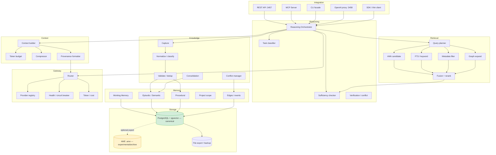

# Semantic Brain — Kiến trúc đích

Tài liệu mô tả kiến trúc mục tiêu cho **External Cognitive Memory & Hybrid Reasoning System**, khả thi trên một máy CPU 16 GB, triển khai tăng dần trên codebase hiện tại. Các quyết định memory chi tiết ở [memory-system.md](./memory-system.md), reasoning ở [hybrid-reasoning.md](./hybrid-reasoning.md), lộ trình ở [implementation-roadmap.md](../roadmap/implementation-roadmap.md).

---

## 1. Mục tiêu và phi mục tiêu

### 1.1. Mục tiêu

1. Một **nguồn sự thật duy nhất** cho tri thức: PostgreSQL + pgvector.
2. **Project isolation** được enforce ở tầng repository, không dựa vào tag OR.
3. **Hybrid retrieval** thực chất: ANN-first + FTS + metadata + code index + graph edge + rerank.
4. **Memory đa tầng**: working, episodic, semantic, procedural, project scope.
5. **Provenance và trust**: phân biệt quan sát/giả thuyết/suy luận/fact/user decision.
6. **Reasoning orchestrator** phối hợp internal knowledge với nhiều LLM, có kiểm chứng.
7. **Context engineering** có ngân sách, ưu tiên, citation, conflict flag.
8. **Đo lường** chất lượng retrieval/reasoning, không chỉ latency.
9. **Tích hợp đa client**: REST, MCP, CLI, OpenAI-compatible.
10. **Vận hành nhẹ**: một Node service + PostgreSQL; không bắt buộc GPU.

### 1.2. Phi mục tiêu (giai đoạn này)

- Không xây chatbot tổng quát.
- Không thay thế LLM bằng model local lớn.
- Không xây graph database riêng; `memory_edge` trong PostgreSQL đủ.
- Không xây event streaming/Kafka.
- Không hỗ trợ multi-region/multi-tenant SaaS.
- Không tự động hóa việc "hiểu" mọi ngôn ngữ; ưu tiên tiếng Việt + tiếng Anh kỹ thuật.

---

## 2. Nguyên tắc kiến trúc

1. **PostgreSQL là canonical.** AME chỉ là adapter thử nghiệm hoặc archive, không dual-write.
2. **Một đường ghi.** Mọi producer đi qua `KnowledgeWriter`; không có SQL ghi rải rác.
3. **Một đường đọc.** Mọi client đi qua `RetrievalEngine`; không có scoring SQL trong handler.
4. **Scope là predicate, không phải gợi ý.** `project_id`/`scope` bắt buộc trong repository.
5. **Trust là dữ liệu, không phải lời hứa.** Mỗi item có `trust_level` + provenance.
6. **LLM không tự ghi fact.** Output model chỉ được `observation`/`inference`.
7. **Retrieval phải chứng minh đủ.** Không đủ thì trả `insufficient_knowledge`.
8. **Đo trước khi tối ưu.** Mọi thay đổi retrieval phải có baseline + golden set.
9. **Tương thích ngược.** Giữ CLI/REST cũ trong chu kỳ chuyển đổi.
10. **Không thêm abstraction không có consumer.** Mỗi module mới phải có test và caller thật.

---

## 3. Sơ đồ kiến trúc đích



---

## 4. Module và trách nhiệm

| Module | Trách nhiệm | Không được làm | File/thư mục đích |
| :--- | :--- | :--- | :--- |
| **Core** | config, logging, errors, ids, clock, schema validation | business logic, SQL | `core/` |
| **Memory Engine** | session, item, edge, event, trust rules, project scope | HTTP, LLM | `core/memory/` |
| **Retrieval Engine** | query plan, ANN, FTS, filter, graph, fusion, rerank, sufficiency signals | ghi dữ liệu | `core/retrieval/` |
| **Knowledge Engine** | capture, normalize, classify, validate, dedup, consolidate, conflict | trả lời trực tiếp | `core/knowledge/` |
| **Reasoning Engine** | intent, policy, workflow, model choice, verification | SQL trực tiếp | `core/reasoning/` |
| **Context Engine** | section builder, budget, compression, citations | gọi provider trực tiếp | `core/context/` |
| **Model Gateway** | provider adapters, router, health, cost, retry | biết về memory schema | `core/gateway/` |
| **Storage Providers** | repository interfaces + PG implementation; AME adapter | domain rules | `core/storage/` |
| **Integration** | REST/MCP/CLI/proxy, auth, rate limit, idempotency | business rules | `server.js`, `mcp/`, `tools/` |

### 4.1. Quy tắc phụ thuộc

```
Integration → Reasoning → {Retrieval, Context, Gateway, Knowledge}
Retrieval → Storage
Knowledge → Memory → Storage
Context → Retrieval (read models) + Gateway (optional compression)
Gateway → (external providers only)
Core ← mọi module
```

- Không có vòng phụ thuộc.
- `Storage` không import `Reasoning`.
- `Gateway` không import `Memory`.
- `Integration` không chứa SQL.

### 4.2. Interface cốt lõi

```js
// core/storage/repository.js
interface MemoryRepository {
  getById(id, scope): Promise<MemoryItem | null>;
  search(plan: SearchPlan): Promise<SearchHit[]>;
  insert(item: MemoryItem): Promise<{ id, version }>;
  update(id, patch, expectedVersion, actor): Promise<MemoryItem>;
  addEdge(edge): Promise<void>;
  neighbors(id, relation, depth): Promise<MemoryItem[]>;
  recordEvent(event): Promise<void>;
}

// core/retrieval/engine.js
interface RetrievalEngine {
  retrieve(request: RetrieveRequest): Promise<RetrieveResult>;
}

// core/knowledge/writer.js
interface KnowledgeWriter {
  capture(input: CaptureInput): Promise<WriteResult>;
  verify(id, evidence, actor): Promise<VerifyResult>;
  consolidate(options): Promise<ConsolidationReport>;
}

// core/gateway/index.js
interface ModelGateway {
  chat(request: ChatRequest): Promise<ChatResponse>;
  embed(texts: string[]): Promise<number[][]>;
  health(): Promise<ProviderHealth[]>;
}
```

---

## 5. Luồng dữ liệu

### 5.1. Ghi

```
Agent/Proxy/User
  → Integration (auth, project, idempotency)
  → KnowledgeWriter.capture
      normalize → classify → validate → dedup
      → trust assignment (theo producer)
      → MemoryRepository.insert/update
      → embedding (batch/async)
      → memory_event
  → nếu conflict: memory_conflict + edge contradicts
  → nếu đủ điều kiện: promote (episodic→semantic) hoặc recipe outcome
```

### 5.2. Đọc

```
Agent
  → Integration (auth, project)
  → RetrievalEngine.retrieve
      query planner: intent + filters + budget
      ANN top K (ORDER BY embedding <=> $1 LIMIT K)
      FTS top K
      metadata filter (project_id, scope, status, trust)
      graph expand (neighbors của top hits)
      fusion (RRF hoặc weighted) + rerank (optional cross-encoder/local)
      sufficiency signals
  → ContextBuilder (budget, sections, citations)
  → trả L0 / L1 / full theo yêu cầu
```

### 5.3. Suy luận

```
ReasoningOrchestrator.run(task)
  → classifier (type, risk, project, constraints)
  → session open/resume
  → retrieve vòng 1
  → sufficiency check
      đủ → context → gateway → validate → answer
      thiếu → retrieve vòng 2 (graph/dependency) → check lại
      vẫn thiếu → insufficient_knowledge
  → conflict check
  → harvest gate
  → session update/close/promote
```

---

## 6. Vòng đời memory và knowledge

### 6.1. Memory lifecycle

```
Session (working) ──done──> Episodic item ──repeat/evidence──> Semantic fact
                                   │                              │
                                   └──stale/archive───────────────┘
Recipe (procedural) ──success/failure──> active/stale/retired
```

### 6.2. Knowledge lifecycle

```
capture → normalize → classify → validate → active
   → retrieve → feedback → reevaluate
   → consolidate (merge/supersede)
   → stale → archived
```

Chi tiết trạng thái và quy tắc ở [memory-system.md](./memory-system.md) §4.

---

## 7. Storage schema đích

### 7.1. Bảng chính

| Bảng | Vai trò | Ghi chú |
| :--- | :--- | :--- |
| `project` | namespace | id, name, root_path, archived_at |
| `memory_session` | working memory | TTL, state JSONB, checkpoint |
| `memory_item` | episodic + semantic | unified, trust/provenance/lifecycle |
| `agent_recipes` | procedural | nâng cấp precondition/postcondition/version |
| `memory_edge` | quan hệ | references/supersedes/contradicts/derived_from |
| `memory_event` | audit append-only | created/updated/verified/merged/archived |
| `memory_conflict` | xung đột | item_a/item_b/type/status/resolution |
| `agent_registry` | skill/workflow index | giữ, thêm embedding_model |
| `agent_codebase_index` | code index | chunk theo symbol, thêm project_id |
| `schema_migrations` | migration | version, applied_at |

### 7.2. Index chiến lược

- `HNSW (embedding vector_cosine_ops)` cho `memory_item`, `agent_recipes`, `agent_codebase_index`.
- `GIN(tags)`, `GIN(keywords)`, `GIN(to_tsvector('simple', search_text))`.
- `BTREE(project_id, status, memory_type)`, `BTREE(project_id, valid_to)`.
- `UNIQUE(project_id, memory_type, content_hash)`.
- Không dùng `ivfflat` cho code index nếu dữ liệu còn nhỏ và thay đổi thường xuyên; HNSW ổn định hơn.

### 7.3. Embedding versioning

- `embedding_model`, `embedding_dims`, `embedded_at` trên mọi bảng có vector.
- Khi đổi model: tạo cột `embedding_v2` hoặc bảng shadow; backfill theo batch; cutover khi đủ; giữ `embedding_model` để tránh so sánh khác chiều.
- Không trộn vector 384 và 1024 trong cùng index.

### 7.4. Migration

- `migrations/001_init.sql`, `002_memory_item.sql`, ...
- Chạy idempotent, có `schema_migrations`.
- `maintenance/setup.js` chỉ gọi migration runner, không tự đoán đường dẫn.
- Docker entrypoint chạy migration trước khi start; fail-fast nếu migration lỗi.

---

## 8. API design

### 8.1. REST (v1)

| Method | Path | Mục đích |
| :--- | :--- | :--- |
| GET | `/health` | liveness + dependency status |
| GET | `/ready` | DB/embedding/gateway ready |
| GET | `/metrics` | Prometheus text |
| POST | `/v1/retrieve` | retrieval có filter/budget |
| POST | `/v1/context` | build context từ task |
| POST | `/v1/reason` | orchestrated answer |
| GET | `/v1/memory/:id` | L1 view |
| POST | `/v1/memory` | write (idempotency key) |
| PATCH | `/v1/memory/:id` | update có version |
| POST | `/v1/memory/:id/verify` | gắn evidence/trust |
| POST | `/v1/memory/:id/feedback` | used/not_useful |
| GET | `/v1/memory/:id/history` | events/versions |
| POST | `/v1/sessions` | mở working memory |
| PATCH | `/v1/sessions/:id` | cập nhật state |
| POST | `/v1/sessions/:id/checkpoint` | checkpoint |
| POST | `/v1/sessions/:id/promote` | promote sang episodic |
| POST | `/v1/recipes/:id/outcome` | success/failure |
| GET | `/v1/conflicts` | danh sách conflict |
| POST | `/v1/conflicts/:id/resolve` | resolve |
| POST | `/v1/admin/consolidate` | dry-run/apply |
| POST | `/v1/admin/eval` | chạy golden set |

**Request mẫu:**

```json
POST /v1/retrieve
{
  "project_id": "semanticbrain",
  "query": "Lỗi deadlock khi commit transaction trong service inventory",
  "task_type": "bug",
  "budget_tokens": 4000,
  "filters": { "memory_type": ["episodic","semantic"], "trust_min": "inference" },
  "include_archived": false
}
```

**Response mẫu:**

```json
{
  "status": "ok",
  "items": [
    {
      "id": 123,
      "title": "Deadlock khi commit ...",
      "snippet": "...",
      "score": 0.78,
      "trust_level": "verified_fact",
      "project_id": "erp",
      "valid_from": "2026-05-01",
      "citations": ["commit:abc123", "test:InventoryDeadlockTests"]
    }
  ],
  "sufficiency": { "level": "partial", "missing": ["schema index"] },
  "tokens_estimated": 1200
}
```

### 8.2. Auth và namespace

- `Authorization: Bearer <token>`; token map tới `client_id` + allowed `project_id` list.
- Admin token riêng cho consolidate/eval/migration.
- Mọi request phải có `X-Project-Id` hoặc `project_id` trong body; server kiểm tra quyền.
- Rate limit theo token/IP (ví dụ 60 req/phút; write 20/phút).
- Body limit 1 MB; JSON schema validation.
- CORS chỉ cho origin cấu hình; mặc định tắt cho write.
- Audit log: actor, action, item_id, before/after hash, IP.

### 8.3. MCP

MCP tools (stdio hoặc HTTP):

| Tool | Input | Output |
| :--- | :--- | :--- |
| `memory.search` | query, project, filters, limit | items + scores |
| `memory.get` | id | full item + history |
| `memory.write` | content, trust, provenance, idempotency | id/version |
| `memory.feedback` | id, used | ok |
| `session.open/update/promote` | task/state | session |
| `context.build` | task, budget | context blocks |
| `reason.run` | task, mode | answer + citations |
| `recipe.report` | id, success | ok |
| `conflicts.list/resolve` | filters | conflicts |

MCP là bề mặt mỏng gọi cùng service layer; không nhân bản logic.

### 8.4. CLI

Giữ lệnh cũ làm wrapper:

| Lệnh cũ | Hành vi mới |
| :--- | :--- |
| `context-fetch.js` | gọi `/v1/context` nếu server sống; fallback `RetrievalEngine` |
| `post-task.js` | gọi `/v1/memory` hoặc `KnowledgeWriter` |
| `find-qa.js` | gọi `/v1/retrieve` mode L1 |
| `view-qa.js` | gọi `/v1/memory/:id` |
| `curate.js` | gọi `/v1/admin/consolidate --dry-run` |
| `stats.js` | gọi `/metrics` + SQL read-only |

Không spawn process con để lưu; dùng HTTP hoặc in-process import.

---

## 9. Model routing và failure handling

Tóm tắt; chi tiết ở [hybrid-reasoning.md](./hybrid-reasoning.md).

| Task | Default | Escalate khi |
| :--- | :--- | :--- |
| classify/tag | rule + local 0.5B | không |
| summarize | local 1.5B | >2k token |
| extract JSON | local 3B | schema fail 2 lần |
| code | cloud coding | offline → local 7B nếu có |
| architecture | cloud mạnh | offline → trả retrieval + đề xuất |
| verify | deterministic | cần semantic judge → cloud (optional) |

| Failure | Hành vi |
| :--- | :--- |
| PG down | 503; không ghi; không trả kết quả cũ |
| embedding fail | retry; 503 nếu vẫn fail |
| Ollama down | cloud nếu có; `degraded=true` |
| cloud down | local; `degraded=true` |
| cả hai down | retrieval-only + citations |
| invalid JSON | retry 1; không lưu |
| conflict | trả cả hai + yêu cầu resolve |

---

## 10. Triển khai và tài nguyên

### 10.1. Topology tối thiểu

```
[Client/Agent] ──HTTP/stdio──> [semantic-brain service :3457]
                                      ├── PostgreSQL 16 + pgvector
                                      ├── Ollama (optional, localhost)
                                      └── cloud APIs (optional)
[OpenAI client] ──HTTP──> [proxy :3458] ──> service
```

- Một process Node cho API + retrieval + orchestrator.
- Một worker tùy chọn cho consolidation/eval (cron hoặc `node worker.js`).
- Không cần Redis/Kafka.

### 10.2. Ngân sách tài nguyên (máy 16 GB)

| Thành phần | RAM ước tính | Ghi chú |
| :--- | ---: | :--- |
| PostgreSQL | 200–500 MB | shared_buffers mặc định |
| Node service | 300–500 MB | + 800 MB khi load BGE-M3 |
| Ollama 1.5B Q4 | 1–2 GB | chỉ khi dùng local LLM |
| OS/khác | 2–4 GB | |
| **Tổng** | **4–7 GB** | còn dư cho IDE/agent |

- Không chạy server + proxy + CLI riêng lẻ mỗi cái load model; CLI ưu tiên gọi server.
- Embedding model load một lần; batch khi index.
- Consolidation chạy ngoài giờ cao điểm.

### 10.3. Docker

- `Dockerfile`: Node 20/22, không copy `node_modules`, healthcheck.
- `docker-compose`: postgres + semantic-brain; migration job; volume cho PG; không hardcode password trong repo (dùng `.env`/secret).
- AME không nằm trong compose mặc định.

---

## 11. Chuyển đổi tăng dần (strangler)

### 11.1. Nguyên tắc

- Không big-bang rewrite.
- Thêm lớp mới song song, chuyển từng entry point.
- Feature flag: `RETRIEVAL_V2`, `WRITE_V2`, `SESSION_ENABLED`, `AME_WRITE=false`.
- So sánh kết quả cũ/mới trên cùng query trước khi cutover.

### 11.2. Các bước

| Bước | Việc | Rollback |
| :--- | :--- | :--- |
| 1 | Thêm migration + cột nullable; backfill | drop cột |
| 2 | Thêm `MemoryRepository` đọc PG; route đọc mới song song | tắt flag |
| 3 | Thêm `KnowledgeWriter`; chuyển `save-qa`/`post-task` | tắt flag |
| 4 | Tắt ghi AME; export/đối soát | bật lại flag (không khuyến nghị) |
| 5 | Thêm `RetrievalEngine` ANN-first; so sánh 100 query | tắt flag |
| 6 | Thêm session/working memory | tắt flag |
| 7 | Thêm gateway/orchestrator | tắt flag |
| 8 | Thêm MCP/auth/SDK | giữ REST cũ |

### 11.3. Tương thích

- Giữ endpoint cũ (`/find-qa`, `/save-qa`, ...) map sang service mới.
- Giữ CLI flags cũ; thêm flag mới.
- Giữ bảng `agent_qa_cache` dưới dạng view khi đổi tên.
- Không đổi format export đột ngột; thêm `_schema_version`.

---

## 12. So sánh phương án storage

| Tiêu chí | A. PG canonical + AME experimental (khuyến nghị) | B. AME canonical | C. Dual-store + sync engine |
| :--- | :--- | :--- | :--- |
| Nhất quán | Cao (một nguồn) | Cao (một nguồn) | Thấp (cần outbox/reconcile) |
| Chất lượng tiếng Việt | Cao (BGE-M3) | Thấp (MiniLM 384) | Phụ thuộc |
| Query linh hoạt (SQL, join, filter) | Cao | Thấp (API hạn chế) | Trung bình |
| Scale 100k | Cao (ANN + partition) | Trung bình (single-file) | Trung bình |
| Vận hành | Đơn giản | Đơn giản | Phức tạp |
| Công sức | Trung bình | Thấp ban đầu, cao về sau | Cao |
| Rủi ro | Thấp | Chất lượng/khóa vendor | Rất cao |
| Kết luận | **Chọn** | Không | Không |

AME vẫn có giá trị: single-file, IPC nhanh, phù hợp archive/offline. Giữ như adapter sau interface, không phải nguồn chính.

---

## 13. Tái sử dụng, refactor, viết mới

### 13.1. Tái sử dụng

- `core/config.js` (mở rộng schema validation).
- `core/embed.js` (giữ cache, thêm batch + TTL + model version).
- `core/keywords.js` (giữ tag rules, thêm vocabulary control).
- `core/queries.js` (giữ làm seed cho retrieval SQL, nhưng đổi ANN-first).
- `tools/find-qa-context.js` (giữ multi-angle + L0/L1, chuyển sang gọi engine).
- `tools/post-task.js` quality guard (giữ regex, thêm trust).
- `tools/project-helper.js` (giữ, thêm project registry).
- `tools/route-decision.js` (giữ risk/tag, đổi tên để không lẫn "System 1").
- `maintenance/export.js` (mở rộng đầy đủ cột).

### 13.2. Refactor

- `server.js`: tách router/handlers/service.
- `openai-proxy.js`: tách RAG injection + harvest, dùng gateway.
- `storage-ame.js`: đưa sau `StorageProvider`, bỏ khỏi write path mặc định.
- `find-qa-deep.js` + bản trong `server.js`: hợp nhất một implementation.
- `save-qa.js`, `auto-harvest.js`, `auto-post-task.js`: đi qua `KnowledgeWriter`.
- `curate.js`, `qa-health.js`: thành consolidation/health jobs.
- `setup.js`: thay bằng migration runner.
- Đường dẫn hardcode: đưa vào config/env, bỏ ERP coupling.

### 13.3. Viết mới

- `core/memory/` (session, item, edge, trust).
- `core/retrieval/` (planner, ANN, fusion, rerank, sufficiency).
- `core/knowledge/` (writer, validator, consolidator, conflict).
- `core/reasoning/` (orchestrator, policy).
- `core/context/` (builder, budget, compressor).
- `core/gateway/` (providers, router, health, cost).
- `migrations/`, `tests/`, `eval/`, `mcp/`.
- Auth/rate limit/observability.

---

## 14. Rủi ro và giảm thiểu

| Rủi ro | Mức | Giảm thiểu |
| :--- | :--- | :--- |
| Migration làm hỏng dữ liệu | Cao | Backup + dry-run + idempotent + rollback |
| Đổi embedding model gây lệch kết quả | Cao | Shadow index + A/B + giữ model cũ |
| Retrieval mới chậm hơn | Trung bình | Benchmark trước/sau; ANN-first; cache |
| Project isolation làm mất kết quả hữu ích | Trung bình | Global scope có kiểm soát; log cross-project |
| Orchestrator quá phức tạp | Trung bình | Bắt đầu bằng workflow tối giản; feature flag |
| Tăng chi phí cloud | Trung bình | Local-first; budget; cost log |
| Không có test → regression | Cao | Golden set + CI trước khi cutover |
| Bảo mật API | Cao | Auth + rate limit + body limit + audit |
| Scope creep (graph/RAG nâng cao) | Trung bình | Bám 7 phase; mỗi phase có acceptance |

---

## 15. Tiêu chí hoàn thành kiến trúc đích

1. Chỉ còn **một** đường ghi và **một** đường đọc chính.
2. Không còn dual-write; AME không nằm trong write path.
3. Mọi query có `project_id` predicate; test chứng minh không rò rỉ.
4. Query lõi dùng ANN và P95 < 100 ms ở 50k bản ghi (mục tiêu; đo lại).
5. Mỗi item có trust/provenance; LLM không tạo `verified_fact`.
6. Working memory + session hoạt động; promote sinh episodic đúng.
7. Consolidation chạy định kỳ, có dry-run và event log.
8. Orchestrator trả `insufficient_knowledge` khi thiếu, có citation.
9. Golden set + CI + metrics chạy tự động.
10. REST/MCP/CLI dùng chung service layer; auth bật mặc định.
